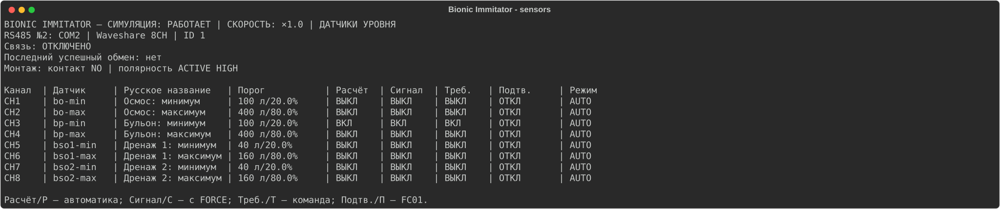
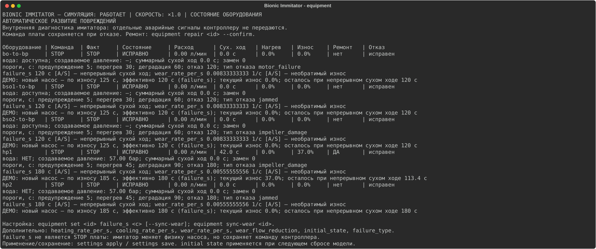
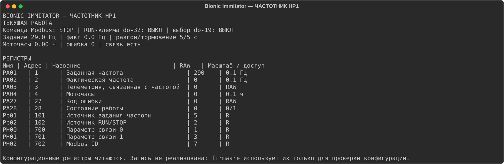
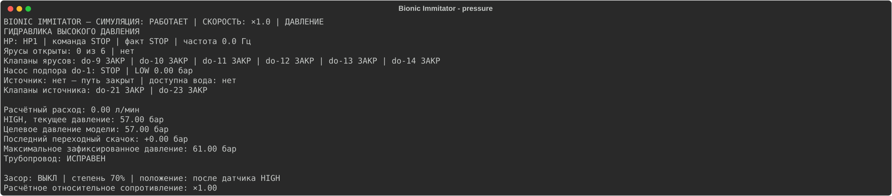
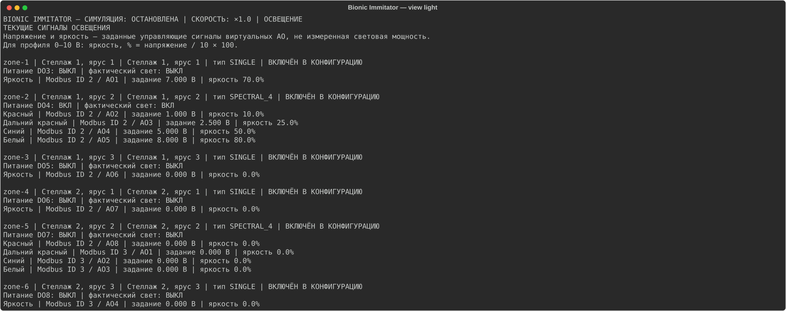
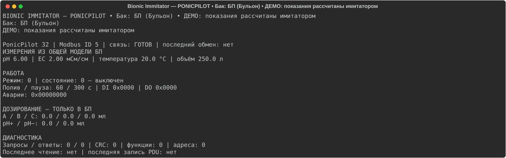
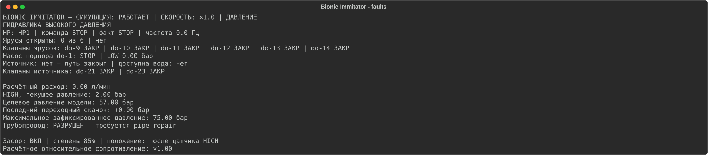
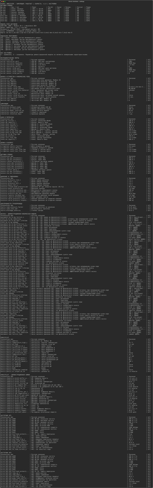

# Bionic Immitator — инструкция пользователя

Инструкция относится к ветке `feature/standforge`. Команды и значения по умолчанию сверены с текущим исходным кодом. Значения физической модели являются демонстрационными, если прямо не указано обратное.

## Оглавление

1. [Назначение программы](#purpose)
2. [Состав испытательного стенда](#stand)
3. [Схема подключения](#wiring)
4. [Требования к компьютеру](#requirements)
5. [Установка в Windows](#windows)
6. [Установка в Linux](#linux)
7. [Первый запуск](#first-run)
8. [Настройка COM-портов](#ports)
9. [Подключение Bionic Mini](#controller)
10. [Настройка Waveshare Relay для датчиков уровня](#relay)
11. [Проверка контактов NO/NC](#contacts)
12. [Настройка виртуальных Modbus-устройств](#virtual-devices)
13. [Главное окно и управление консолью](#tui)
14. [Команды управления симуляцией](#simulation)
15. [Настройка баков](#tanks)
16. [Настройка порогов MIN/MAX](#thresholds)
17. [Управление насосами и диагностика](#pumps)
18. [Настройка частотников HP1/HP2](#drives)
19. [Модель давления](#pressure)
20. [Настройка освещения по ярусам](#lights)
21. [Настройка PonicPilot](#ponics)
22. [Настройка химических параметров воды](#chemistry)
23. [Настройка аварий и физических повреждений](#faults)
24. [Время сухого хода и отказа насосов](#dry-run)
25. [Применение и сохранение настроек](#saving-settings)
26. [Сохранение и восстановление состояния испытания](#checkpoints)
27. [Журнал событий](#journal)
28. [Проведение испытаний](#tests)
29. [Типовые неисправности и способы диагностики](#troubleshooting)
30. [Справочник всех команд](#commands)
31. [Справочник всех параметров конфигурации](#configuration)
32. [Ограничения имитатора](#limitations)

<a id="purpose"></a>
## 1. Назначение программы

Bionic Immitator принимает штатные команды платы Bionic Mini по Modbus RTU, моделирует баки, потоки, насосы, давление, свет, раствор и неисправности и возвращает сигналы через подтверждённые каналы оборудования. Имитатор не меняет прошивку, WEB или backend платы и не создаёт скрытых аварийных входов.

Внутренние аварии видны в TUI и журнале. Плата узнаёт о последствиях только по штатным датчикам, аналоговому давлению, регистрам реальных виртуальных устройств и их штатной диагностике. Имитатор не отправляет STOP насосу.

<a id="stand"></a>
## 2. Состав испытательного стенда

| Узел | Роль |
|---|---|
| Компьютер с Bionic Immitator | Модель физики и Modbus-устройства |
| Bionic Mini | Испытуемый контроллер |
| USB–RS485 №1 | Общая шина виртуальных slave-устройств |
| USB–RS485 №2 | Master-линия к физическому Waveshare Relay 8/16CH |
| Waveshare Relay | Сухие контакты восьми датчиков уровня |
| Проводка датчиков | COM и NO либо NC к штатным входам Bionic Mini |

Без оборудования можно проверять модель, TUI, команды, Modbus-логику и контрольные точки. Реакцию реальной платы, электрические контакты и конкретные USB-преобразователи проверяют только на стенде.

<a id="wiring"></a>
## 3. Схема подключения

```text
                         USB №1 / RS-485
Bionic Mini (master) <====================> ПК: виртуальные slave
                                                ID1 Relay 32CH
                                                ID2..4 AO
                                                ID5 PonicPilot
                                                ID6 Waveshare AI (давление)
                                                ID7 HP1, ID8 HP2

ПК (master) ========= USB №2 / RS-485 ======> Waveshare Relay ID1
                                                    CH1..CH8, сухие контакты
                                                    │
                                                    └──> штатные входы MIN/MAX платы
```

Не соединяйте USB №1 и USB №2 в одну логическую линию. Давление передаётся через виртуальный штатный Waveshare AI на USB №1, а не через реле уровня. Номера физических клемм платы здесь не приводятся: используйте актуальную электрическую схему Bionic Mini.

<a id="requirements"></a>
## 4. Требования к компьютеру

- Windows 10/11 либо современный Linux.
- Git и `uv`.
- Python 3.11+ устанавливается/выбирается через `uv`.
- Два независимых последовательных порта для полного аппаратного стенда.
- Права текущего пользователя на COM или `/dev/tty*`.
- Терминал с поддержкой UTF-8 и полноэкранного интерфейса.

<a id="windows"></a>
## 5. Установка в Windows

```powershell
git clone --branch feature/standforge git@github.com:xels79/rtu-forge.git
Set-Location rtu-forge
.\setup.ps1
rtuforge paths
bionic-immitator --help
```

SSH можно заменить HTTPS. Установка выполняется для текущего пользователя и создаёт `bionic-immitator.exe`. По умолчанию данные Bionic находятся в подкаталоге `bionic-data` выбранного DataDir.

Обновление:

```powershell
git switch feature/standforge
git pull --ff-only
.\setup.ps1
```

Собственный каталог данных:

```powershell
bionic-immitator --home C:\Bionic\test-01
bionic-immitator --home C:\Bionic\test-01 --no-controller
```

<a id="linux"></a>
## 6. Установка в Linux

```bash
git clone --branch feature/standforge git@github.com:xels79/rtu-forge.git
cd rtu-forge
chmod +x setup.sh
./setup.sh
rtuforge paths
bionic-immitator --help
```

Не запускайте `setup.sh` через `sudo`: установщик сам запрещает root. Для обновления выполните `git pull --ff-only` и снова `./setup.sh`. Пример отдельного DataDir:

```bash
bionic-immitator --home "$HOME/bionic/test-01"
bionic-immitator --home "$HOME/bionic/test-01" --no-controller
```

Если порт недоступен, проверьте `ls -l /dev/ttyUSB* /dev/ttyACM*` и членство пользователя в системной группе последовательных портов. Название группы зависит от дистрибутива.

<a id="first-run"></a>
## 7. Первый запуск

Для разработки из checkout:

```powershell
uv sync --extra dev
uv run bionic-immitator --home .\bionic-data --no-controller
```

Команда `--no-controller` не открывает USB №1. Она подходит для знакомства и программных сценариев. Откройте `view settings`, задайте порты, затем выполните `settings save`. Файл `bionic-immitator.ini` не создаётся от просмотра справки или статуса.

Для запуска с платой уберите `--no-controller`. USB №2 открывается только при `hardware_mode=true`.

<a id="ports"></a>
## 8. Настройка COM-портов

```text
settings set controller_port COM5
settings set sensor_relay_port COM6
settings set controller_baudrate 9600
settings set sensor_relay_baudrate 9600
settings apply
settings save
view ports
```

В Linux вместо `COM5` укажите, например, `/dev/ttyUSB0`. Порты должны отличаться. Изменение соединения возвращает признак переподключения; TUI переоткрывает устройства после применения.

<a id="controller"></a>
## 9. Подключение Bionic Mini

1. Отключите питание перед изменением проводки.
2. Соедините A/B/GND USB №1 с RS‑485 Bionic Mini согласно схемам устройств.
3. Проверьте скорость, чётность и стоп-биты.
4. Запустите имитатор без `--no-controller`.
5. Откройте `view rs485`, `view devices`, `view drives`.
6. Подайте одну штатную команду платы и убедитесь, что она появилась в журнале.

Не запускайте два процесса на одном порту. Имитатор является slave на USB №1 и не должен самовольно управлять выходами платы.

<a id="relay"></a>
## 10. Настройка Waveshare Relay для датчиков уровня

Заводская карта:

| Канал | Датчик | Бак |
|---:|---|---|
| CH1 | `bo-min` | БО, минимум |
| CH2 | `bo-max` | БО, максимум |
| CH3 | `bp-min` | БП, минимум |
| CH4 | `bp-max` | БП, максимум |
| CH5 | `bso1-min` | БСО1, минимум |
| CH6 | `bso1-max` | БСО1, максимум |
| CH7 | `bso2-min` | БСО2, минимум |
| CH8 | `bso2-max` | БСО2, максимум |

```text
settings set sensor_relay_port COM6
settings set sensor_relay_id 1
settings set sensor_relay_channels 8
settings set hardware_mode true
settings apply
settings save
view sensors
```

Страница показывает расчётный сигнал, команду реле и подтверждение FC01. При потере связи значение не выдаётся за подтверждённое, а событие записывается в журнал. После восстановления связи имитатор повторно записывает полный правильный образ реле через FC0F, проверяет его через FC01 и журналирует успешную синхронизацию.



<a id="contacts"></a>
## 11. Проверка контактов NO/NC

`COM` — общий контакт реле. `NO` разомкнут без срабатывания, `NC` замкнут. `sensor_relay_contact` документирует фактическую монтажную пару, а `sensor_relay_active_low` задаёт программную полярность команды реле. Эти параметры не заменяют проверку мультиметром.

1. Отключите вход платы.
2. Прозвоните COM–NO и COM–NC при выключенном и включённом CH.
3. Подключите только подтверждённую пару.
4. Задайте `sensor_relay_contact NO` или `NC`.
5. Если конкретный модуль требует инверсии, задайте `sensor_relay_active_low true`.
6. Сравните «Сигнал», «Треб.» и «Подтв.» на `view sensors`.

Ручное переключение DO имитатора запрещено, кроме явно запущенного `--test-mode`; это не заменяет электрическую проверку.

<a id="virtual-devices"></a>
## 12. Настройка виртуальных Modbus-устройств

| Устройство | ID по умолчанию | Назначение |
|---|---:|---|
| Relay 32CH | 1 | Штатные DO платы |
| AO №1/2/3 | 2/3/4 | Аналоговые задания света |
| PonicPilot 32 | 5, фиксирован | Бак БП |
| Waveshare AI | 6 | HIGH/LOW давление |
| IDD HP1/HP2 | 7/8 | Частотники |

ID должны быть уникальны, 1..247. PonicPilot допускает только ID 5. Меняйте через `settings set <имя> <ID>`, затем `settings apply` и `settings save`.

<a id="tui"></a>
## 13. Главное окно и управление консолью

Верхняя строка всегда показывает `СИМУЛЯЦИЯ: РАБОТАЕТ/ПАУЗА` и скорость. Командная строка остаётся неподвижной при обновлении.

| Клавиша | Действие |
|---|---|
| F1..F6 | справка, настройки, статус, устройства, порты, журнал |
| колесо, PgUp/PgDn | прокрутка текущей страницы |
| Tab | контекстное дополнение |
| Up/Down | история команд |
| Esc+K / Esc+J | предыдущая/следующая редактируемая строка |
| Enter на выбранной строке | подготовить команду изменения |
| F5 или Esc+A | применить черновик; на странице света — только свет |
| Ctrl+S | сохранить; на странице света — только свет |
| Esc | вернуться без применения |
| Ctrl+C / Ctrl+D | выход |

Страницы: `status`, `devices`, `ports`, `settings`, `help`, `log`, `rs485`, `tanks`, `pumps`, `equipment`, `pressure`, `irrigation`, `light`, `light settings`, `sensors`, `water`, `ponics`, `ponics settings`, `ponics registers`, `drives`, `drive hp1`, `drive hp2`. Каждая страница доступна командой `view ...`; значения изменяются профильными командами либо через выбранную строку настроек.

| Страница | Что показывает | Как изменить / пример |
|---|---|---|
| `view status` | баки, насосы, процесс, три события | штатными командами платы или профильными CLI-командами |
| `view devices` | русские имена, Modbus ID, DO | `settings set hp1_address 17` |
| `view ports` | обе линии и их формат | `settings set controller_port COM5` |
| `view settings` | все группы, черновик, A/S, датчики и модель отказа | выбрать строку, Enter; F5 применить, Ctrl+S сохранить |
| `view help` | группы команд и поиск | `help search износ` |
| `view log` | время, тип, объект, событие | `log filter alarms` |
| `view rs485` | порты и адреса USB №1 | изменять через `settings set` |
| `view tanks` | объём, ёмкость, MIN/MAX, перелив | `tank bo level 300` |
| `view pumps` | команда и расход transfer-помп | `pump bo-to-bp flow 9` |
| `view equipment` | команда/факт, сухой ход, нагрев, износ, ресурс, ремонт | `equipment status hp1` |
| `view pressure` | HP, клапаны, путь воды, расход, цели/пики, труба | `fault blockage on` |
| `view irrigation` | шесть ярусов и расходы | `irrigation shelf 1 flow-per-tier 2.5` |
| `view light` | все DO/AO и эффективное свечение | команды выполняет плата; карта меняется через `light set` |
| `view light settings` | черновая карта каждого яруса и конфликты | выбрать ярус; F5/Ctrl+S только для света |
| `view sensors` | пороги, расчёт/force, CH, команда и FC01 | выбрать датчик; `sensor bo-min threshold 75` |
| `view water` | состав четырёх баков и потоки | химия через `settings set`, дозы через `ponics dose` |
| `view ponics` | измерения БП, режим, дозы и диагностика | `ponics dose a 10` |
| `view ponics settings` | writable PDU и инженерные значения | выбрать строку либо `ponics set 33 275` |
| `view ponics registers` | все 42 регистра, RAW/HEX, источник/время | штатная запись Modbus или `ponics set` |
| `view drives` | сводка HP1/HP2 | параметры `hp1_*`, `hp2_*` |
| `view drive hp1` | работа, защита и регистры HP1 | `settings set hp1_pb02 1` |
| `view drive hp2` | работа, защита и регистры HP2 | `settings set hp2_pb02 2` |

На всех страницах работают прокрутка, история, Tab, Esc и общие F-клавиши. Редактирование выбранной строки действует только на страницах `settings`, `sensors`, `ponics settings` и `light settings`.

<a id="simulation"></a>
## 14. Команды управления симуляцией

```text
sim start
sim pause
sim resume
sim speed 1
sim speed 5
sim reset --confirm
```

`sim pause` останавливает расчёт физики, но не закрывает RS‑485 и не отправляет STOP. `sim reset` создаёт новую виртуальную модель; подтверждение обязательно. Настройка скорости сохраняется как `simulation_speed`, если выполнить `settings save`.

<a id="tanks"></a>
## 15. Настройка баков

`view tanks` показывает текущий/предельный объём, независимые MIN/MAX и перелив. `view water` добавляет EC, pH, температуру и потоки.

```text
tank list
tank bo level 250
tank bp level 60%
tank bo capacity 600
tank bo fill-rate 4.5
```

Уровень — текущее состояние и сам по себе не сохраняется в конфигурации; используйте контрольную точку. Ёмкость меняет черновик настройки. Уменьшить её ниже текущего объёма или MAX нельзя. Изменение ёмкости не перемещает абсолютные датчики.

<a id="thresholds"></a>
## 16. Настройка порогов MIN/MAX

Для каждого бака требуется `0 ≤ MIN < MAX ≤ ёмкость`.

```text
sensor bo-min threshold 75
sensor bo-max threshold 410
settings save
view sensors
```

MAX означает положение датчика, а не полный бак. После MAX наполнение продолжается, пока плата не закроет клапан. Переполнение возникает только после физической ёмкости. `sensor <id> force on|off` — временное состояние испытания; `sensor <id> auto` возвращает расчёт.

<a id="pumps"></a>
## 17. Управление насосами и диагностика

`view pumps` показывает перекачивающие насосы. `view equipment` показывает команду платы, фактическую работу, расход, воду, сухой ход, нагрев, износ, отказ и необходимость ремонта. Насосы управляются только штатными DO/частотником; CLI не запускает их.

```text
pump bo-to-bp flow 10
equipment status hp1
equipment repair hp1 --confirm
equipment replace bo-to-bp --confirm
```

`repair` сбрасывает повреждение выбранного устройства. `replace` также увеличивает счётчик замен. Команда платы не изменяется: при активном RUN отремонтированный насос может немедленно запуститься.



<a id="drives"></a>
## 18. Настройка частотников HP1/HP2

`view drives` сравнивает источник RUN, Modbus, клемму, selector, факт, частоту, ток и ошибку. `view drive hp1` и `view drive hp2` показывают регистры, RAW, расшифрованные инженерные значения/режимы и защиту. На общей странице `view settings` регистровые настройки частотников также показаны вместе с расшифровкой текущего значения.



`PB.02=1` использует клемму RUN, `PB.02=2` — Modbus-регистр. Команды не объединяются через OR. Selector остаётся частью подтверждённой схемы выбора насоса. Примеры стартового профиля:

```text
settings set hp1_pb02 1
settings set hp1_ramp_up_s 7
settings set hp1_nominal_current_a 15
settings apply
settings save
```

Внутренняя защита IDD может остановить двигатель, сохранив RUN платы. RESET частотника не ремонтирует механику.

<a id="pressure"></a>
## 19. Модель давления

`view pressure` показывает частоту HP, RUN/STOP, клапаны ярусов, источник, расчётный расход, текущее/целевое/максимальное давление, последний пик, сопротивление и состояние трубы.



При 42 Гц и трёх открытых ярусах целевое демонстрационное давление около 57 бар. Закрытие ярусов быстро повышает давление; открытие снижает. Без источника, подпора или воды нормальная подача не создаётся. Засор расположен после HIGH, повышает сопротивление, уменьшает расход и повышает показание HIGH. При 75 бар по умолчанию возникает `PIPE_RUPTURE`, давление падает до 0–3 бар, а ремонт выполняется `pipe repair`. Автоматический STOP не отправляется.

<a id="lights"></a>
## 20. Настройка освещения по ярусам

`view light` показывает все шесть ярусов, включая выключенные: тип, DO3–DO8, фактическое питание, ID/AO, напряжение и расчётную яркость. При 0–10 В яркость равна `напряжение / 10 × 100`. Если DO выключен, сохранённые 7 В показываются как 70%, но фактический свет — ВЫКЛ.



`view light settings` редактирует каждый ярус независимо: `NONE`, `SINGLE`, `SPECTRAL_4`. Конфликты AO запрещены.

```text
light set zone-1 type SINGLE
light set zone-1 channel brightness 2 1
light set zone-1 voltage 0 10
light set zone-1 brightness 0 100
light apply
light save
```

Для спектрального света назначьте `red`, `far_red`, `blue`, `white`. `light restore-defaults` меняет только черновик света. Переназначение не записывает новые значения в реальные выходы платы.

<a id="ponics"></a>
## 21. Настройка PonicPilot

PonicPilot всегда имеет ID 5 и обслуживает только БП. Выбора бака нет. На страницах постоянно показаны «Бак: БП (Бульон)» и «ДЕМО: показания рассчитаны имитатором».



```text
view ponics
view ponics settings
view ponics registers
ponics set 33 275
ponics dose a 10
ponics fault ph on
```

Запись настроечного регистра обновляет черновик; для постоянного профиля выполните `settings save`. Дозы A/B/C/pH+/pH− меняют только БП. Другие баки меняются через физические потоки.

<a id="chemistry"></a>
## 22. Настройка химических параметров воды

`view water` показывает расчётные EC, pH и температуру. Начальные профили задаются для осмоса, БП и дренажей; процессы задают поглощение, осаждение, дрейф pH и силу дозирования. При фактическом поливе раствор деградирует: модель удаляет часть питательных веществ, учитывает осаждение и изменяет pH возвращаемой воды. PonicPilot видит последствия после физического возврата и перекачки раствора в БП.

```text
settings set osmosis_ec_ms_cm 0.08
settings set broth_initial_ph 5.9
settings set nutrient_absorption_fraction 0.06
settings set plant_water_uptake_fraction 0.005
settings set irrigation_evaporation_fraction 0.002
settings apply
settings save
```

Начальные значения применяются к раствору при новом запуске/сбросе, а обычное применение не должно самопроизвольно заменить текущую воду. Все химические величины — демонстрационная расчётная модель, не лабораторное измерение. Полевые данные по брокколи подтверждают существенную зависимость водопотребления от стадии и условий выращивания, а исследования рециркуляционной гидропоники показывают накопление дисбаланса отдельных ионов даже при поддержании целевой EC. Поэтому коэффициенты стенда намеренно редактируемые и не выдаются за измеренные характеристики конкретной аэропонной установки: [broccoli ET research](https://desertagsolutions.org/research-areas-and-initiatives/increasing-irrigation-efficiency/water-use-and-management/updated-crop-evapotranspiration-et-salinity-management/broccoli), [recycled nutrient solution study](https://pubmed.ncbi.nlm.nih.gov/33414800/).

<a id="faults"></a>
## 23. Настройка аварий и физических повреждений

```text
fault leak rate 12
fault leak on
fault blockage severity 70
fault blockage on
fault pump hp1 jammed
fault list
fault clear all
alarm list
alarm reset all
pipe repair
```

`fault blockage off` снимает засор, но не ремонтирует уже разрушенную трубу. `fault clear all` отключает протечку и засор, но также не ремонтирует трубу. Внутренние события не превращаются в дополнительные входы платы.



<a id="dry-run"></a>
## 24. Время сухого хода и отказа насосов

Есть два независимых механизма:

- `failure_s` — порог непрерывного сухого хода;
- `wear_rate_per_s` — необратимый износ, накапливаемый после `dry_run_warning_s`.

Раньше сработает меньший расчётный срок. `view settings` и `view equipment` показывают прямой порог, срок по износу, эффективный срок, текущий износ, остаток и A/S. Это демонстрационная модель. `failure_s` не является временем STOP платы.

Рекомендуемая синхронизация:

```text
equipment set hp1 failure_s 240 --sync-wear
settings apply
settings save
```

Эквивалентно можно сначала изменить время, затем выполнить `equipment sync-wear hp1`. Скорость рассчитывается как `1 / (failure_s - dry_run_warning_s)`. Текущий износ не обнуляется, поэтому изношенный насос может отказать раньше. Для нового HP1 приведённый профиль даёт отказ приблизительно на 240-й секунде непрерывного сухого хода.

<a id="saving-settings"></a>
## 25. Применение и сохранение настроек

| Слой | Значение |
|---|---|
| Черновик | отредактирован, но может не действовать и не быть на диске |
| Применено (A) | используется текущей моделью |
| Сохранено (S) | записано в `bionic-immitator.ini` для следующего запуска |
| Физическое состояние | вода, износ, аварии, труба; отдельно от конфигурации |

Правильная последовательность:

```text
equipment set hp1 failure_s 240 --sync-wear
settings apply
settings save
view equipment
```

`settings apply` не сохраняет файл и не ремонтирует насосы. `settings save` сохраняет черновик, но не применяет его к уже работающей модели. Файл пишется во временный файл и атомарно заменяется. При переходе старого формата создаётся `.v1.bak`. Ошибка записи не считается успехом.

<a id="checkpoints"></a>
## 26. Сохранение и восстановление состояния испытания

```text
sim state save before-blockage
sim state list
sim state load before-blockage --confirm
```

Контрольная точка в `simulation-states/<имя>.json` содержит объёмы и состав, повреждения, очереди возврата, давление, разрыв, потери, аварии и диагностику PonicPilot. Она не содержит DO, AO, Modbus RUN-регистры и заданную платой частоту. При загрузке текущие команды платы сохраняются; если они активны, оборудование может сразу воздействовать на восстановленное состояние.

При любом штатном выходе тот же физический состав автоматически и атомарно сохраняется в `<home>/bionic-runtime-state.json`, а при следующем запуске восстанавливается. Состояние сохраняется между запусками до явной команды `sim reset --confirm`; reset сразу заменяет автоматический снимок начальным состоянием. Команды контроллера DO/AO/RUN и заданная им частота в автоматический снимок также не входят и после запуска поступают только от платы.

<a id="journal"></a>
## 27. Журнал событий

`view log` показывает события модели и обмена. На главном экране остаются три последних записи.

```text
log last 50
log filter alarms
log filter rs485
log filter ponics
log export result.csv
```

Фильтры: `alarms`, `rs485`, `tanks`, `pumps`, `ponics`, `all`. PonicPilot
фиксирует первое успешное чтение pH, EC, температуры и состояния, затем только
изменения штатных регистров; одинаковые циклические опросы не засоряют журнал.
Запись настройки и дозирование содержат русское название, значение с единицей
измерения и источник команды. Для каждого события
`do-N` журнал сохраняет технический номер и русское назначение выхода, например
`do-22 | Клапан наполнения осмоса: ВКЛ → ВЫКЛ`. Неназначенные каналы помечаются как
резервные. Относительный путь экспорта разрешается от DataDir. Срок хранения
задаёт `retention_days`. Дата и время журнала сохраняются в локальном часовом
поясе компьютера с числовым смещением UTC. Старые записи UTC при чтении и
экспорте преобразуются в текущее локальное время компьютера.

<a id="tests"></a>
## 28. Проведение испытаний

Перед каждым опасным сценарием сохраните контрольную точку. Без платы можно проверить физику и журнал; пункт «реакция платы» требует оборудования.

| Сценарий | Исходные условия и действия | Ожидаемая модель / датчики | Ожидаемая плата и восстановление |
|---|---|---|---|
| Нормальное наполнение БО | БО ниже MAX; плата открывает DO22 | объём растёт, MIN затем MAX включаются | плата должна закрыть DO22 по своей логике; сохранить журнал |
| Игнорирование MAX | оставить DO22 после MAX | наполнение продолжается; после ёмкости `TANK_OVERFLOW` | контроллер должен выявить проблему штатно; закрыть DO22, вернуть checkpoint |
| Нормальная откачка | есть вода, DO2 включён | БО уменьшается, БП растёт, есть расход | плата штатно останавливает насос |
| Игнорирование MIN | держать DO2 при пустом БО | MIN снимается, сухой ход и износ растут | проверить реакцию платы; `equipment repair ... --confirm` |
| Отказ перекачки | довести сухой ход до failure | расход падает, команда DO остаётся | плата видит только реальные последствия; ремонт |
| HP без подпора | выбран источник, HP RUN, DO1 выключен | нет нормального давления, HP изнашивается | плата должна реагировать на LOW/HIGH; восстановить подпор и ремонт |
| Закрытие ярусов | 42 Гц, три яруса, затем закрывать | расход падает, HIGH быстро растёт | проверить штатную реакцию; открыть ярусы |
| Засор | `fault blockage severity 70`, затем `on` | сопротивление растёт, расход падает, HIGH растёт | STOP не отправляется; `fault blockage off` |
| Разрыв трубы | довести расчёт до 75 бар | `PIPE_RUPTURE`, HIGH 0–3 бар, потеря воды | проверить реакцию платы; `pipe repair` |
| Защита ПЧ | создать ток выше порога на время trip | IDD переходит TRIPPED, мотор останавливается, RUN остаётся | выполнить штатный RESET, механику ремонтировать отдельно |
| Повторный запуск | оставить RUN после физического отказа | насос не восстанавливается сам | плата видит последствия; затем ремонт с предупреждением об активном RUN |
| Ремонт | `equipment repair hp1 --confirm` | износ и отказ выбранного насоса сброшены | команда платы не изменена |
| Освещение | DO ON/OFF и AO 7 В | задание 70%; фактический свет зависит от DO | сравнить команды платы на `view light` |
| PonicPilot | записать параметры/дозу | меняется только состав БП | сверить штатные регистры ID5 |
| Потеря реле датчиков | отключить USB №2 | `НЕТ СВЯЗИ`, старое FC01 не выдаётся за актуальное | проверить поведение платы по физическим контактам; восстановить линию |

Для каждого аппаратного теста заранее зафиксируйте: цель, настройки, команды платы, ожидаемые датчики, ожидаемое оборудование, реакцию платы и строки журнала. После теста отключите инициированную неисправность, выполните необходимый ремонт и загрузите контрольную точку только с `--confirm`.

<a id="troubleshooting"></a>
## 29. Типовые неисправности и способы диагностики

| Симптом | Проверка | Решение |
|---|---|---|
| USB №1 не открывается | `view ports`, занятость порта | закрыть второй процесс, исправить имя и применить |
| USB №2 «НЕТ СВЯЗИ» | ID, A/B, питание, `hardware_mode` | исправить линию, полярность и адрес |
| Реле подтверждает обратное | COM/NO/NC и active-low | прозвонить контакты, исправить два независимых параметра |
| HP не запускается | selector, PB.02, клемма/регистр, PA.27 | использовать ровно выбранный источник RUN, сбросить штатную защиту |
| Давление нулевое | источник, вода, подпор, HP, разрыв | восстановить реальный путь; при разрыве `pipe repair` |
| Насос отказал раньше `failure_s` | `view equipment`, срок по износу | синхронизировать wear-rate либо учитывать накопленный износ |
| Настройка исчезла | A/S на `view settings` | выполнить и apply, и save в нужном порядке |
| Вода/авария исчезла после рестарта | это состояние, не конфигурация | явно загрузить именованную контрольную точку |
| Свет имеет 70%, но не светит | состояние DO | это корректно: AO сохраняется при выключенном питании |

<a id="commands"></a>
## 30. Справочник всех команд

В колонке «Сохранение» «состояние» означает контрольную точку, «Save» — `settings save` или отдельный `light save`.

| Команда | Назначение и аргументы | Пример / результат | Сохранение |
|---|---|---|---|
| `status` | открыть главный экран | `status` | нет |
| `devices`, `ports` | страницы устройств/портов | `ports` | нет |
| `help [search <текст>]` | справка/поиск | `help search pressure` | нет |
| `view <page>` | открыть реализованную страницу | `view pressure` | нет |
| `tank list` | список баков | `tank list` | нет |
| `tank <id> level <л\|N%>` | текущий объём | `tank bp level 60%` | состояние |
| `tank <id> capacity <л>` | ёмкость в черновике и модели | `tank bo capacity 600` | Save |
| `tank bo fill-rate <л/мин>` | текущий расход наполнения | `tank bo fill-rate 4` | через соответствующую настройку для перезапуска |
| `pump list` | насосы | `pump list` | нет |
| `pump <id> flow <л/мин>` | текущий номинальный расход | `pump bo-to-bp flow 9` | через настройку для перезапуска |
| `equipment list` | страница диагностики | `equipment list` | нет |
| `equipment status <id>` | строка состояния | `equipment status hp1` | нет |
| `equipment repair\|replace <id> --confirm` | ремонт/замена | `equipment repair hp1 --confirm` | состояние |
| `equipment set <id> <поле> <значение> [--sync-wear]` | изменить профиль | `equipment set hp1 failure_s 240 --sync-wear` | Save |
| `equipment sync-wear <id>` | синхронизировать wear-rate | `equipment sync-wear hp1` | Save |
| `irrigation shelf <1\|2> flow-per-tier <л/мин>` | расход яруса | `irrigation shelf 1 flow-per-tier 2.5` | через настройку для перезапуска |
| `pressure target <бар>` | журналируемая рабочая цель | `pressure target 57` | нет |
| `pressure range <мин> <макс>` | текущий предел модели | `pressure range 0 90` | через настройку для перезапуска |
| `pressure rise-time\|fall-time <с>` | текущая динамика | `pressure rise-time 5` | через настройку для перезапуска |
| `pipe rupture-threshold <бар>` | текущий порог разрыва | `pipe rupture-threshold 75` | через настройку для перезапуска |
| `pipe status`, `pipe repair` | статус/ремонт трубы | `pipe repair` | состояние |
| `sensor list` | страница датчиков | `sensor list` | нет |
| `sensor <id> threshold <л>` | абсолютный порог | `sensor bo-max threshold 410` | Save |
| `sensor <id> force on\|off`, `auto` | временное состояние | `sensor bo-min auto` | состояние |
| `fault leak on\|off`, `rate <л/мин>` | протечка | `fault leak on` | состояние; базовая интенсивность — Save |
| `fault blockage on\|off`, `severity <0..100>` | засор после HIGH | `fault blockage severity 70` | состояние; базовая степень — Save |
| `fault pump hp1\|hp2 <тип>` | физический отказ HP | `fault pump hp1 jammed` | состояние |
| `fault list`, `fault clear all` | список/снятие leak+blockage | `fault list` | состояние |
| `alarm list`, `alarm reset all` | аварии/квитирование завершённых | `alarm reset all` | состояние |
| `sim start\|pause\|resume` | расчёт физики | `sim pause` | нет |
| `sim speed <0.1..100>` | скорость | `sim speed 5` | `simulation_speed` через Save |
| `sim reset --confirm` | новая модель | `sim reset --confirm` | нет |
| `sim state save <имя>` | записать checkpoint | `sim state save test-1` | сразу |
| `sim state list` | список checkpoint | `sim state list` | нет |
| `sim state load <имя> --confirm` | восстановить физику | `sim state load test-1 --confirm` | читает состояние |
| `light settings` / `view light settings` | настройки света | `view light settings` | нет |
| `light set <zone> type <NONE\|SINGLE\|SPECTRAL_4>` | тип | `light set zone-2 type SPECTRAL_4` | light Save |
| `light set <zone> rack\|tier\|relay <N>` | расположение/DO | `light set zone-1 relay 3` | light Save |
| `light set <zone> enabled on\|off` | включение в профиль | `light set zone-1 enabled on` | light Save |
| `light set <zone> name <текст>` | русское имя | `light set zone-1 name Стеллаж 1 ярус 1` | light Save |
| `light set <zone> channel <role> <ID> <AO>` | физическая привязка | `light set zone-2 channel red 2 2` | light Save |
| `light set <zone> voltage <min> <max>` | диапазон 0..10 В | `light set zone-1 voltage 0 10` | light Save |
| `light set <zone> brightness <min> <max>` | диапазон процентов | `light set zone-1 brightness 0 100` | light Save |
| `light apply`, `light save` | применить/сохранить только свет | `light apply` | по команде |
| `light restore-defaults` | заводской черновик света | `light restore-defaults` | требуется apply/save |
| `ponics dose <a\|b\|c\|ph_plus\|ph_minus> <мл>` | доза в БП | `ponics dose a 10` | состояние |
| `ponics set <PDU> <RAW>` | штатный writable register | `ponics set 33 275` | Save для стартового профиля |
| `ponics fault <имя> on\|off` | offline/sensor/doser fault | `ponics fault ec on` | состояние |
| `log last <N>` | последние события | `log last 100` | нет |
| `log filter <alarms\|rs485\|tanks\|pumps\|all>` | фильтр | `log filter rs485` | нет |
| `log export <файл.csv>` | экспорт | `log export result.csv` | сразу |
| `settings list` | открыть настройки | `settings list` | нет |
| `settings set <имя> <значение>` | изменить черновик | `settings set pressure_rise_s 6` | требуется apply/save |
| `settings apply`, `settings save` | применить / атомарно сохранить | `settings apply` | по команде |
| `relay force <1..32> on\|off` | тестовый DO, только `--test-mode` | `relay force 22 on` | нет |
| `exit`, `quit` | выход | `exit` | нет |

Поля `equipment set`: `dry_run_warning_s`, `overheat_s`, `degrade_s`, `failure_s`, `heating_rate_per_s`, `cooling_rate_per_s`, `wear_rate_per_s`, `wear_flow_reduction`, `initial_state`, `failure_type`. ID оборудования: `bo-to-bp`, `bso1-to-bp`, `bso2-to-bp`, `hp1`, `hp2`.

<a id="configuration"></a>
## 31. Справочник всех параметров конфигурации

Все параметры меняются `settings set <имя> <значение>`, начинают действовать после `settings apply` и хранятся в `bionic-immitator.ini` после `settings save`, если таблица не указывает специальный интерфейс. `true/false` — логические значения. «ДЕМО-физика» означает расчётный, не измеренный параметр.

### Последовательные порты, устройства и служебные параметры

| Имя | Русское назначение | Ед.; по умолчанию | Допустимо / влияние |
|---|---|---|---|
| `controller_port` | USB №1 | `COM1` | путь порта; соединение |
| `controller_baudrate` | скорость USB №1 | 9600 бод | положительное; соединение |
| `controller_parity` | чётность USB №1 | `N` | формат pyserial; соединение |
| `controller_stopbits` | стоп-биты USB №1 | 1 | формат pyserial; соединение |
| `sensor_relay_port` | USB №2 | `COM2` | другой порт; соединение |
| `sensor_relay_baudrate` | скорость USB №2 | 9600 бод | положительное; соединение |
| `sensor_relay_parity` | чётность USB №2 | `N` | формат pyserial |
| `sensor_relay_stopbits` | стоп-биты USB №2 | 1 | формат pyserial |
| `sensor_relay_id` | ID физического реле | 1 | 1..247 |
| `sensor_relay_channels` | число реле | 8 | 8 или 16 |
| `sensor_relay_active_low` | инверсия команды | false | логическое; электрическая интерпретация |
| `sensor_relay_contact` | монтажный контакт | `NO` | `NO`/`NC`; документация монтажа |
| `sensor_relay_map` | восемь sensor:channel | заводская CH1..CH8 | все датчики, уникальные допустимые каналы |
| `sensor_relay_loss_behavior` | потеря связи | `unknown` | `hold`/`unknown` |
| `hardware_mode` | открыть USB №2 | false | логическое; оборудование |
| `relay_address` | Relay 32CH ID | 1 | 1..247, уникальный |
| `ao1_address`, `ao2_address`, `ao3_address` | AO ID | 2, 3, 4 | 1..247, уникальные |
| `ai_address` | AI давления ID | 6 | 1..247, уникальный |
| `ponics_address` | PonicPilot ID | 5 | только 5 |
| `hp1_address`, `hp2_address` | ID частотников | 7, 8 | 1..247, уникальные |
| `model_interval_ms` | период физики | 50 мс | >0; производительность/точность |
| `ui_interval_ms` | обновление TUI | 500 мс | >0; только интерфейс |
| `retention_days` | хранение журнала | 7 дней | неотрицательное; журнал |
| `simulation_speed` | множитель времени | 1.0 | 0.1..100; ДЕМО-физика |

### Баки, датчики и потоки

| Имя | Назначение | По умолчанию | Диапазон / влияние |
|---|---|---:|---|
| `bo_capacity_l`, `bp_capacity_l` | ёмкости БО/БП | 500 л | >0; ДЕМО-физика |
| `bso1_capacity_l`, `bso2_capacity_l` | ёмкости дренажей | 200 л | >0; ДЕМО-физика |
| `bo_initial_l`, `bp_initial_l` | стартовый объём | 250 л | 0..ёмкость; только новая модель |
| `bso1_initial_l`, `bso2_initial_l` | стартовый объём | 20 л | 0..ёмкость; только новая модель |
| `bo_min_threshold_l`, `bo_max_threshold_l` | MIN/MAX БО | 100/400 л | `0≤MIN<MAX≤capacity` |
| `bp_min_threshold_l`, `bp_max_threshold_l` | MIN/MAX БП | 100/400 л | то же |
| `bso1_min_threshold_l`, `bso1_max_threshold_l` | MIN/MAX БСО1 | 40/160 л | то же |
| `bso2_min_threshold_l`, `bso2_max_threshold_l` | MIN/MAX БСО2 | 40/160 л | то же |
| `sensor_hysteresis_l` | гистерезис датчиков | 0 л | ≥0; ДЕМО-физика |
| `sensor_delay_s` | задержка датчиков | 0 с | ≥0; ДЕМО-физика |
| `fill_flow_lpm` | наполнение БО | 3 л/мин | ≥0; ДЕМО-физика |
| `water_meter_initial_l` | начальное показание счётчика входящей воды | 0 л | ≥0; действует при новой модели и `sim reset --confirm` |
| `bo_to_bp_flow_lpm` | БО→БП | 10 л/мин | ≥0; ДЕМО-физика |
| `bso1_to_bp_flow_lpm`, `bso2_to_bp_flow_lpm` | дренажи→БП | 8 л/мин | ≥0; ДЕМО-физика |
| `rack1_tier_flow_lpm`, `rack2_tier_flow_lpm` | расход яруса | 2 л/мин | ≥0; ДЕМО-физика |
| `return_fraction` | доля возврата | 0.8 | 0..1; ДЕМО-физика |
| `return_delay_s` | задержка возврата | 5 с | ≥0; ДЕМО-физика |
| `plant_water_uptake_fraction` | поглощение воды растениями за проход | 0.005 | 0..1; ДЕМО, не измерено |
| `irrigation_evaporation_fraction` | испарение воды за проход | 0.002 | 0..1; ДЕМО, не измерено |

### Давление и неисправности

| Имя | Назначение | По умолчанию | Диапазон / влияние |
|---|---|---:|---|
| `boost_pressure_bar` | напор подпора | 2 бар | ≥0; ДЕМО-физика |
| `boost_rise_s`, `boost_fall_s` | рост/спад LOW | 2/2 с | ≥0; ДЕМО-физика |
| `pressure_rise_s`, `pressure_fall_s` | разгон/спад HP | 5/4 с | ≥0; ДЕМО-физика |
| `valve_pressure_response_ms` | открытие клапана | 200 мс | ≥0; ДЕМО-физика |
| `valve_pressure_close_response_ms` | закрытие клапана | 200 мс | ≥0; ДЕМО-физика |
| `transient_pressure_spike_coefficient` | коэффициент пика | 0 | ≥0; ДЕМО, не измеренный гидроудар |
| `transient_pressure_spike_duration_ms` | длительность пика | 100 мс | ≥0; ДЕМО-физика |
| `closed_head_pressure_bar` | напор при закрытых ярусах | 90 бар | ≥0; ДЕМО-физика |
| `pressure_max_bar` | предел модели | 90 бар | ≥0; ДЕМО-физика |
| `rupture_threshold_bar` | разрыв | 75 бар | ≥0; ДЕМО-физика |
| `rupture_residual_bar` | давление после разрыва | 2 бар | 0..3; ДЕМО-физика |
| `leak_rate_lpm` | расход протечки | 12 л/мин | ≥0; ДЕМО-физика |
| `leak_pressure_factor` | потеря давления | 0.25 | 0..1; ДЕМО-физика |
| `blockage_severity` | заводская степень засора | 70% | 0..100; ДЕМО-физика |

### PonicPilot и химия

| Имя | Назначение | По умолчанию | Диапазон / влияние |
|---|---|---:|---|
| `ponics_irrigation_on_s`, `ponics_irrigation_pause_s` | полив/пауза | 60/300 с | 0..65535; регистры 8/9 |
| `ponics_mode` | режим | 0 | 0,2,3,4,5 |
| `ponics_ph_enabled` | регулятор pH | false | логическое |
| `ponics_ph_dosing_pause_s` | пауза pH | 60 с | 0..65535 |
| `ponics_ph_low`, `ponics_ph_high` | диапазон pH | 5.5/6.5 | 0..14, упорядочен |
| `ponics_ec_enabled`, `ponics_ec_protection_enabled` | EC/защита | false/false | логические |
| `ponics_ec_dosing_pause_s` | пауза EC | 60 с | 0..65535 |
| `ponics_ec_program` | программа EC | 0 | 0..4 |
| `ponics_ec_target_ms_cm` | цель EC | 2.0 мСм/см | 0..20 |
| `ponics_fertilizer_a_share`, `ponics_fertilizer_b_share`, `ponics_fertilizer_c_share` | доли A/B/C | 33/33/34 | каждая 0..99, сумма >0 |
| `ponics_thermostat_enabled` | термостат | false | логическое |
| `ponics_temperature_low_c`, `ponics_temperature_high_c` | диапазон | 18/24 °C | 0..100, упорядочен |
| `tap_ec_ms_cm`, `tap_ph`, `tap_temperature_c`, `tap_buffer_per_l` | справочный профиль водопровода | 0.5; 7.2; 18; 0.8 | EC/buffer ≥0, pH 0..14; только отображение — подтверждённого пути водопровода нет |
| `osmosis_ec_ms_cm`, `osmosis_ph`, `osmosis_temperature_c`, `osmosis_buffer_per_l` | профиль осмоса | 0.1; 6.8; 20; 0.3 | те же правила; ДЕМО |
| `broth_initial_ec_ms_cm`, `broth_initial_ph`, `broth_initial_temperature_c`, `broth_buffer_per_l` | старт БП | 2.0; 6.0; 20; 1.0 | новая модель; ДЕМО |
| `drain_initial_ec_ms_cm`, `drain_initial_ph`, `drain_initial_temperature_c`, `drain_buffer_per_l` | старт дренажей | 1.8; 6.1; 20; 0.8 | новая модель; ДЕМО |
| `nutrient_absorption_fraction` | поглощение | 0.05 | 0..1; ДЕМО |
| `deposition_fraction` | осаждение | 0.01 | 0..1; сумма с absorption ≤1 |
| `ph_drift_per_pass` | дрейф pH | 0.02 | ≥0; ДЕМО |
| `fertilizer_ec_per_ml_at_100l` | действие удобрения | 0.01 | ≥0; ДЕМО |
| `ph_reagent_delta_per_ml_at_100l` | действие pH реагента | 0.02 | ≥0; ДЕМО |

### Частотники

Каждое имя существует отдельно с префиксом `hp1_` и `hp2_`; значения по умолчанию одинаковы.

| Имена | Назначение | По умолчанию | Диапазон / влияние |
|---|---|---:|---|
| `hp1_ramp_up_s`, `hp2_ramp_up_s` | разгон | 5 с | ≥0; IDD PB.07 |
| `hp1_ramp_down_s`, `hp2_ramp_down_s` | торможение | 5 с | ≥0; PB.08 |
| `hp1_pb00`, `hp2_pb00` | локальная частота RAW×0.1 | 290 | валидатор IDD |
| `hp1_pb01`, `hp2_pb01` | источник частоты | 5 | валидатор IDD |
| `hp1_pb02`, `hp2_pb02` | источник RUN | 2 | 0 панель, 1 клеммы, 2 Modbus |
| `hp1_pb05`, `hp2_pb05` | max частота RAW×0.1 | 500 | валидатор IDD |
| `hp1_pb06`, `hp2_pb06` | min частота RAW×0.1 | 200 | валидатор IDD |
| `hp1_pc12`, `hp2_pc12` | номинальные об/мин | 1460 | валидатор IDD |
| `hp1_pc15`, `hp2_pc15` | номинальная частота RAW×0.1 | 500 | валидатор IDD |
| `hp1_ph00`, `hp2_ph00` | служебный PH.00 | 1 | валидатор IDD |
| `hp1_ph01`, `hp2_ph01` | служебный PH.01 | 3 | валидатор IDD |
| `hp1_nominal_current_a`, `hp2_nominal_current_a` | номинальный ток | 16 А | >0; ДЕМО нагрузки |
| `hp1_no_load_current_a`, `hp2_no_load_current_a` | холостой ток | 4 А | 0..номинального; ДЕМО |
| `hp1_pump_load_coefficient`, `hp2_pump_load_coefficient` | нагрузка насоса | 1 | ≥0; ДЕМО |
| `hp1_jam_current_multiplier`, `hp2_jam_current_multiplier` | ток заклинивания | 2 | >0; ДЕМО |
| `hp1_overload_trip_s`, `hp2_overload_trip_s` | выдержка перегруза | 60 с | ≥0; ДЕМО защиты |
| `hp1_overload_protection_enabled`, `hp2_overload_protection_enabled` | защита | true | логическое; штатный регистр |
| `hp1_overload_threshold_multiplier`, `hp2_overload_threshold_multiplier` | порог перегруза | 1.5 | >0; ДЕМО |
| `hp1_protection_behavior`, `hp2_protection_behavior` | поведение защиты | `latched_reset` | только подтверждённый вариант |

### Профили оборудования и света

`equipment_profile` — JSON-профиль пяти насосов. Его следует менять командой `equipment set`, а не вручную. Каждый насос имеет все поля ниже.

| Поле | Значение transfer / HP | Правило |
|---|---|---|
| `dry_run_warning_s` | 5 / 5 с | `0≤warning≤overheat≤degrade≤failure` |
| `overheat_s` | 30 / 45 с | ДЕМО |
| `degrade_s` | 60 / 90 с | ДЕМО |
| `failure_s` | 120 / 180 с | ДЕМО, прямой непрерывный порог |
| `heating_rate_per_s` | 1/30 / 1/45 | ≥0; ДЕМО |
| `cooling_rate_per_s` | 0.02 | ≥0; ДЕМО |
| `wear_rate_per_s` | 1/120 / 1/180 | ≥0; необратимый износ |
| `wear_flow_reduction` | 0.8 | 0..1 |
| `initial_state` | `HEALTHY` | одно из состояний модели; действует на новой модели |
| `failure_type` | зависит от насоса | `jammed`, `impeller_damage`, `motor_failure`, `loss_of_prime` |

`light_profile` — JSON-карта шести ярусов; меняется командами `light set`. Для каждого яруса хранятся `id`, `rack`, `tier`, `name`, `light_type`, `power_relay`, список `{role, device_id, channel}`, диапазоны напряжения/яркости и `enabled`. Типы: `NONE`, `SINGLE`, `SPECTRAL_4`; AO уникальны и должны существовать. Заводская карта подробно видна на `view light settings`.



<a id="limitations"></a>
## 32. Ограничения имитатора

- Физические коэффициенты давления, химии, тепла и износа демонстрационные; они не заменяют измерения конкретной установки.
- Пик давления по умолчанию отключён (`coefficient=0`), поэтому не выдаётся за измеренный гидроудар.
- Имитатор не создаёт несуществующие аварийные входы или Modbus-регистры и не подменяет датчики для удобства диагностики.
- Внутренние аварии видны оператору, но плата обнаруживает их только по штатным физическим последствиям.
- Имитатор не отправляет STOP. Защитные действия выполняет Bionic Mini или штатная защита IDD.
- Проверка проводки, электрических уровней, задержек реальных устройств и реакции прошивки требует физического стенда; автоматические тесты используют fake/mocked transport и ничего не посылают в serial.
- Текущая физика автоматически восстанавливается из `bionic-runtime-state.json`; конфигурация и команды контроллера остаются отделены от состояния.
- Контрольная точка намеренно не восстанавливает команды DO/AO/RUN/частоты контроллера.
- Номера клемм платы не документированы без подтверждённой электрической схемы.
